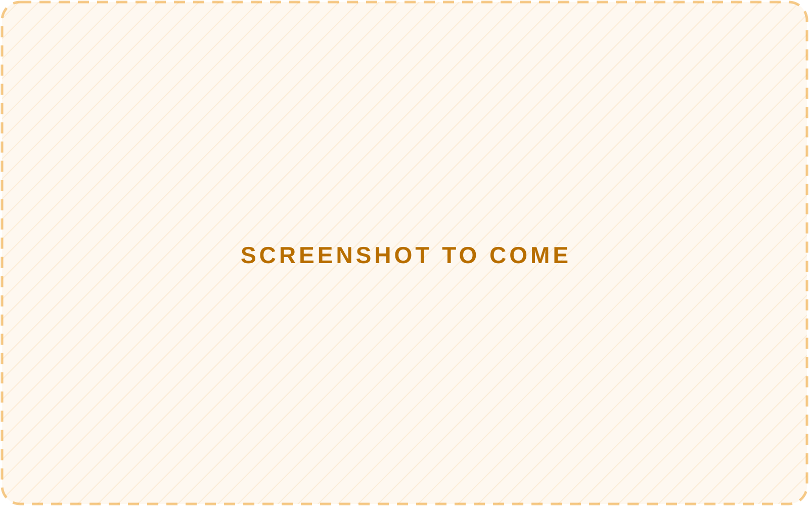

Set up recordings and streams in **Settings › Capture**.

## Livestreaming

Stream any screen and its sound to **YouTube**, **Facebook**, **Twitch**, **Vimeo** or any **RTMP** server. The service's address is filled in, so only the stream key needs pasting. Stream keys are kept in the Keychain, never in your library, and never synced.

You can also stream on the **Local Network** for an overflow room or a phone in the building, with a code to scan.

While you're live, **LIVE** and its time show beside the window's title, with how much is going out and the way to end it.

<Frame caption="To capture: Settings › Capture › Livestream with YouTube selected.">
  
</Frame>

## Recording

Record a screen with its sound — the sermon for YouTube, or the audio alone for a podcast — with captions and chapters. Choose the format, size, frame rate and folder in **Settings › Capture**.

Start and stop from the **Screens** menu on the Mac, or let a slide do it with **Add Action › Recording**.

Recordings and livestreams can also be started and stopped from the [Capture panel](/presenting/cameras#the-capture-panel).

## Lining up sound with the cameras

A camera's picture arrives a little after the sound — a Slipity Camera over Wi-Fi typically 100–250 ms. Each audio input in **Settings › Inputs** has a **Delay** that holds its sound back in recordings and livestreams to match.

- **Automatic** (to begin with) measures how far behind the cameras in use are as each recording or livestream starts, and shows what it would use now.
- **Manual** sets it yourself, in steps of 10 ms. Switching to Manual starts from what Automatic last measured.

The delay applies to recordings and livestreams only, not to the sound in the room.
